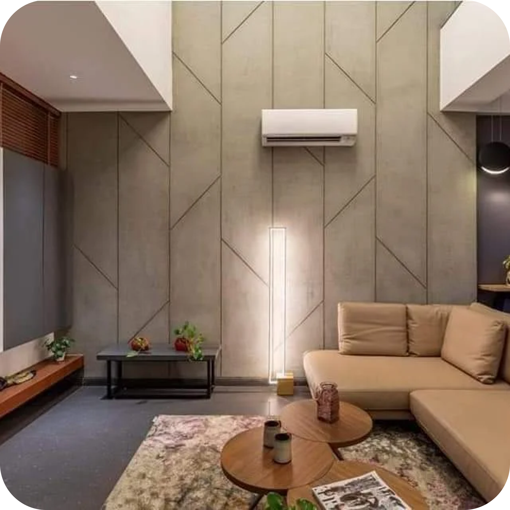
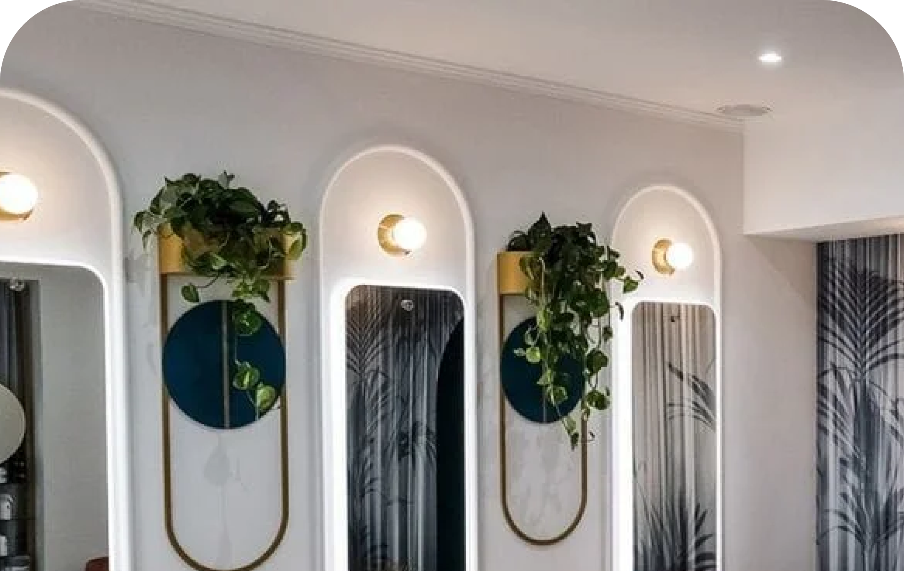
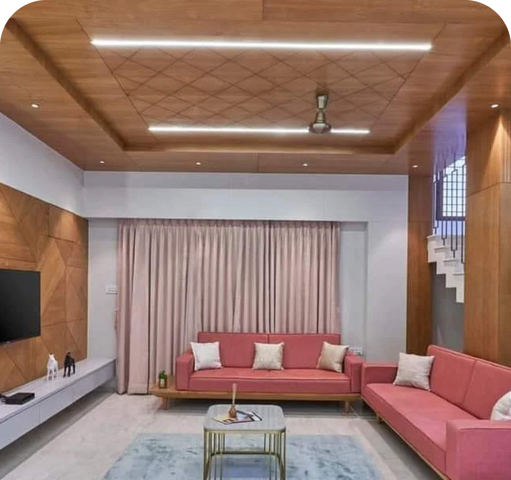

<div align="center">


# Visualize Interior

**Explore, imagine, and generate interior designs from your phone.**

A cross-platform mobile app for **Visualize Interior Design**. Browse curated interiors, see the studio's real projects, and turn a text prompt into an AI-generated room concept.


<br/>





</div>

---

## ✨ Features

| | Feature | What it does |
|---|---|---|
| 🏠 | **Explore** | A gallery of 18 hand-picked interiors (living rooms, bedrooms, kitchens, offices, Mandirs, retail). Tap any design to open a full write-up of its materials, lighting, and mood. |
| 🖼️ | **Portfolio** | A showcase of the studio's completed residential and commercial projects. |
| 🪄 | **AI Image Generator** | Describe a room, like *"Japandi bedroom with warm oak and soft linen"*, and get a design concept back in seconds from Stability AI's Stable Image Core. |
| 👥 | **About Us** | The studio's story, the cities it serves (Pune, Mumbai, Bangalore, Ahmedabad and more), and the team. |
| 🔐 | **Accounts** | Email/password sign-up and login with Firebase Authentication. *(Currently disabled in navigation and being reworked; see [Roadmap](#-roadmap).)* |

## 🛠 Tech Stack

- **[Expo](https://expo.dev) + React Native**: one codebase for iOS and Android
- **React Navigation**: bottom tabs plus native stack transitions
- **Redux Toolkit**: app state
- **Firebase Auth**: user accounts
- **Stability AI API**: text-to-image generation
- **Expo Media Library / Sharing**: save and share designs

## 🚀 Getting Started

### Prerequisites

- [Node.js](https://nodejs.org) 18+
- The [Expo Go](https://expo.dev/go) app on your phone, or an iOS Simulator / Android Emulator
- A [Stability AI API key](https://platform.stability.ai/account/keys)

### Setup

```bash
git clone https://github.com/Zrrkrr/VisualizeInterior.git
cd VisualizeInterior
npm install
cp .env.example .env   # then paste your Stability API key into .env
npx expo start
```

Scan the QR code with Expo Go, or press `i` (iOS) or `a` (Android) to open a simulator.

> 🔒 **Never commit `.env`.** It is git-ignored. Keep your API keys private.

## 📁 Project Structure

```
VisualizeInterior/
├── App.js                 # Root: Redux Provider + NavigationContainer
├── firebase.js            # Firebase app & auth initialisation
├── navigation/
│   └── AppNav.js          # Stack + bottom-tab navigators
├── screen/
│   ├── Home.js            # Explore gallery
│   ├── Description.js     # Design detail page
│   ├── Portfolio.js       # Studio projects
│   ├── Camera.js          # AI image generator
│   ├── ImageDetailScreen.js # Save / share a generated image
│   ├── AboutUs.js         # Studio & team
│   ├── Login.js
│   └── Signup.js
├── features/              # Redux slices (store, images, portfolio, user name)
└── assets/                # Gallery, portfolio, team & icon images
```

## 🗺 Roadmap

The app is being redesigned. Planned work:

- [ ] **AI Room Redesign**: photograph your own room, pick a style, and see it redesigned with a before/after slider
- [ ] Move AI generation behind a secure backend (no API key in the app)
- [ ] Re-enable accounts with persistent login and password reset
- [ ] Save and share generated designs to your gallery
- [ ] Favorites and personal moodboards synced to your account
- [ ] Book a consultation with the studio in your city
- [ ] Portfolio loaded from a CMS, with category filters
- [ ] Dark mode, accessibility improvements, smaller image assets
- [ ] Upgrade to the latest Expo SDK

See [`docs/AUDIT.md`](docs/AUDIT.md) for the full technical audit.

## 🤝 Contributing

Issues and pull requests are welcome. For larger changes, please open an issue first to discuss what you'd like to change.

## 👤 Author

**Ajinkya Wankhede** · [@Zrrkrr](https://github.com/Zrrkrr)

Built for **Visualize Interior Design**, which turns your dreams into reality.

---

<div align="center">If you like this project, consider giving it a ⭐</div>
