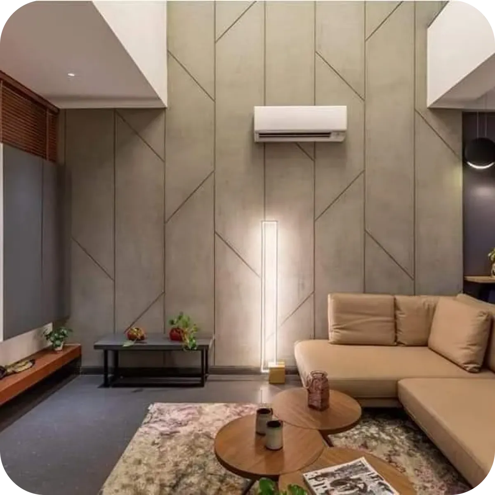
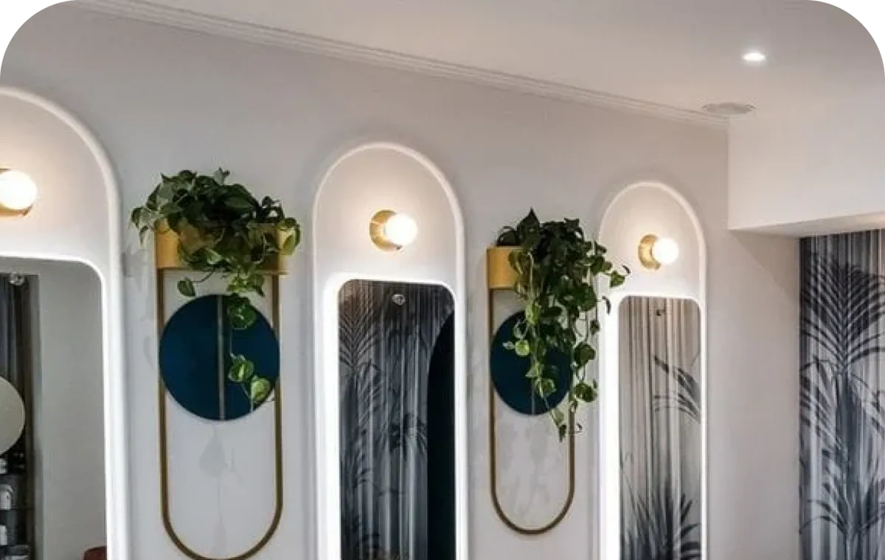
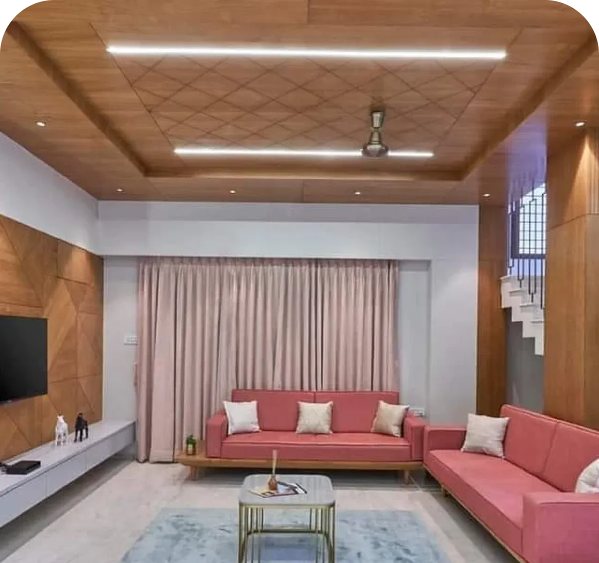

<div align="center">


# Visualize Interior

**Explore interiors, then see your own room redesigned by AI.**

A cross-platform app for **Visualize Interior Design**. Browse curated interiors and the studio's projects, photograph your room, pick a style, and watch it transform.


<br/>





</div>

---

## ✨ Features

| | Feature | What it does |
|---|---|---|
| 🪄 | **AI Room Redesign** | Upload or snap a photo of your room, pick a style (Modern, Japandi, Luxury Gold, Indian Contemporary…), and get a restyled version that **keeps your room's layout**. Compare them with a draggable before/after slider. |
| ✍️ | **Imagine from text** | Describe any room and generate a photorealistic concept. |
| 💾 | **Save & share** | Save designs to your photo library or share them, on iOS, Android and the web. |
| 🏠 | **Explore** | 18 curated interiors with room-type filters and a detail page for each design. |
| 🖼️ | **Portfolio** | The studio's residential and commercial projects. |
| 🔐 | **Accounts** | Email sign-up and login with Firebase. Sessions persist across restarts, password reset works, and errors are explained in plain language. |
| 👥 | **About** | The studio's story, the 12 cities it serves, and the team. |

## 🛠 Tech Stack

- **[Expo](https://expo.dev) SDK 58 + Expo Router**: file-based navigation, one codebase for iOS, Android and web
- **TypeScript** (strict)
- **Firebase Auth** (JS SDK) with persistent sessions
- **Stability AI**: `control/structure` for room redesigns, `generate/core` for text-to-image
- **expo-image, expo-image-picker, expo-image-manipulator**: fast cached images, and photos resized before upload
- **expo-media-library, expo-sharing**: save and share results
- Custom design system: Playfair Display + Inter, warm editorial palette

## 🚀 Getting Started

```bash
git clone https://github.com/Zrrkrr/VisualizeInterior.git
cd VisualizeInterior
npm install
cp .env.example .env    # add your Stability AI key
npx expo start
```

Scan the QR code with **Expo Go**, or press `w` for web, `i` for the iOS simulator, `a` for Android.

> 🔒 `.env` is git-ignored. Get a key at [platform.stability.ai](https://platform.stability.ai/account/keys).

## 📁 Project Structure

```
src/
├── app/                     # Screens (Expo Router)
│   ├── (auth)/              # login, signup, forgot password
│   ├── (tabs)/              # Explore, AI Studio, Portfolio, Profile
│   └── inspiration/[id].tsx # design detail
├── lib/
│   ├── firebase.ts          # Firebase app + persistent auth
│   ├── auth.tsx             # auth context, sign in/up/out, friendly errors
│   ├── stability.ts         # AI calls + photo preparation
│   └── media.ts             # save / share (native + web)
├── content.ts               # typed content: inspirations, projects, styles, team
├── BeforeAfter.tsx          # draggable comparison slider
├── ui.tsx                   # design-system components
└── theme.ts                 # colors, fonts, spacing
assets/content/              # optimized WebP images
```

## 📝 Notes

- **Rebuilt from scratch** in 2026. The original Expo 51 app is in the git history, and [`docs/AUDIT.md`](docs/AUDIT.md) lists what was fixed: a leaked API key, broken save/share, lost logins, and 14 MB of images (now 1.3 MB).
- The Stability key is read from `.env` on the device, which is fine for a demo. A published version would move the AI calls behind a server function.

## 👤 Author

**Ajinkya Wankhede** · [@Zrrkrr](https://github.com/Zrrkrr)

Built for **Visualize Interior Design**, which turns your dreams into reality.
